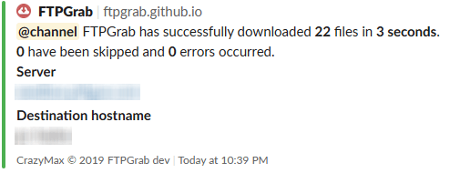

# Slack notifications

You can send notifications to your Slack channel using an [incoming webhook URL](https://api.slack.com/messaging/webhooks).

!!! hint
    Mattermost webhooks are compatible with Slack notification without any special configuration (if Webhooks are enabled).

## Configuration

!!! example "File"
    ```yaml
    notif:
      slack:
        webhookURL: https://hooks.slack.com/services/ABCD12EFG/HIJK34LMN/01234567890abcdefghij
        timeout: 10s
    ```

!!! abstract "Environment variables"
    * `FTPGRAB_NOTIF_SLACK_WEBHOOKURL`
    * `FTPGRAB_NOTIF_SLACK_WEBHOOKURLFILE`
    * `FTPGRAB_NOTIF_SLACK_TIMEOUT`
    * `FTPGRAB_NOTIF_SLACK_PROXY`
    * `FTPGRAB_NOTIF_SLACK_TLSSKIPVERIFY`
    * `FTPGRAB_NOTIF_SLACK_TLSCACERTFILES` (comma separated)

| Name                 | Default | Description                                                            |
| -------------------- | ------- | ---------------------------------------------------------------------- |
| `webhookURL`[^1]     |         | Slack [incoming webhook URL](https://api.slack.com/messaging/webhooks) |
| `webhookURLFile`[^1] |         | Secret file used when `webhookURL` is unset                            |
| `timeout`            | `10s`   | Timeout for each HTTP request                                          |
| `proxy`              |         | Explicit proxy URL                                                     |
| `tlsSkipVerify`      | `false` | Skip TLS certificate verification                                      |
| `tlsCaCertFiles`     |         | Custom CA PEM files (replace system roots)                             |

## Sample



[^1]: One of `webhookURL` or `webhookURLFile` is required.
